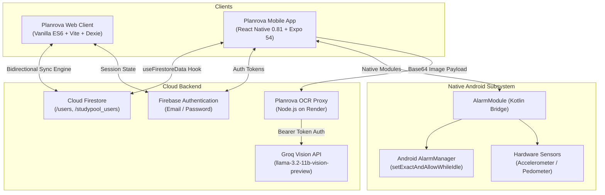
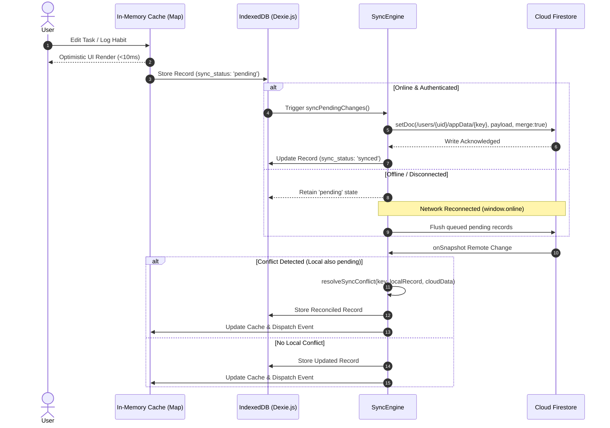
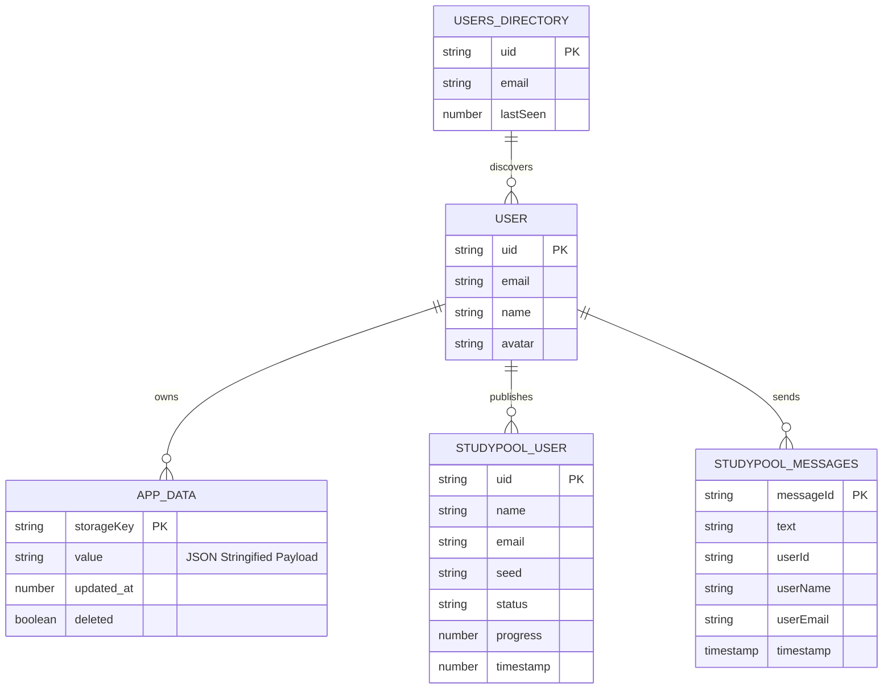
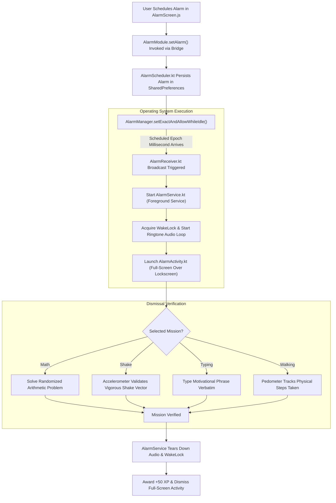

# Planrova

> **Multi-Platform Academic Productivity, Local-First Planning & Gamified Study Ecosystem**  
> *Engineered with Vanilla ES6, React Native (Expo 54), Android Native Kotlin Bridges, Cloud Firestore, and Groq Vision OCR.*

---

## 1. Executive Overview

**Planrova** is a multi-platform academic planning, personal productivity, and social study ecosystem designed specifically for high school and university students. Combining a zero-virtual-DOM desktop web application, a React Native mobile companion app, an Android native exact-alarm subsystem, and an isolated multimodal AI vision proxy, Planrova bridges the gap between structured academic organization and habit formation.

Rather than relying on passive text lists or commercial spreadsheets, Planrova implements an RPG-style progression loop where student focus time, class attendance, hydration, and budgeting fuel an evolving virtual vitality core. Built with an offline-first distributed architecture, Planrova ensures that students retain full access to their schedules, notes, and study tools across campus basements, subway commutes, and high-latency mobile networks.

---

## 2. Problem Statement & Solution

### The Problem
- **Productivity Fragmentation:** Students manage separate, disconnected applications for timetables, habit trackers, Pomodoro timers, personal budgeting, and notebook digitizers.
- **Fragile Cloud Dependency:** Mainstream web-based planners break or drop user inputs when campus Wi-Fi drops or during underground transit commutes.
- **Passive Alarm Ineffectiveness:** Default smartphone alarms are easily dismissed in a half-asleep state without cognitive activation, causing missed morning lectures.
- **Input Friction:** Manually transcribing paper syllabi, class schedules, and handwritten whiteboard notes into digital planners consumes valuable study time.

### The Solution
Planrova unifies these distinct workflows into a single cohesive, local-first ecosystem:
1. **Local-First Synchronization:** Optimistic, zero-latency reads/writes against an in-memory cache and IndexedDB (Dexie.js), replicated asynchronously to Cloud Firestore with custom conflict resolution.
2. **Native Android Alarm Missions:** An Android Kotlin native bridge using `AlarmManager.setExactAndAllowWhileIdle` and hardware sensors (accelerometer, pedometer) that requires solving math problems or walking across the room to dismiss.
3. **Multimodal Vision OCR Pipeline:** Physical lecture notes and syllabus calendars are photographed on mobile, forwarded through a credential-isolated Node.js proxy, and transcribed into formatted Markdown by Groq's LLaMA 3.2 Vision LLM.
4. **Real-Time Social Study Rooms:** Synchronized virtual study lounges with live presence heartbeats, buddy focus percentages, and automated peer encouragement.

---

## 3. Technology Stack

```
+-------------------------------------------------------------------------------------------------+
|                                     PLANROVA ECOSYSTEM STACK                                    |
+--------------------------------+--------------------------------+-------------------------------+
| WEB WORKSPACE                  | MOBILE COMPANION               | BACKEND & CLOUD               |
| • JavaScript (ES6 Modules)     | • React Native 0.81.5          | • Node.js (Built-in HTTP/S)   |
| • Vite 8.0.12 (Bundler & HMR)  | • Expo SDK 54 (Managed + CNG)  | • Groq Vision API (LLaMA 3.2) |
| • Dexie.js 4.4.2 (IndexedDB)   | • Kotlin Native Android Bridge | • Google Cloud Firestore      |
| • Firebase Auth & Firestore    | • React Navigation 7.x         | • Firebase Authentication     |
| • Service Worker (Offline PWA) | • Expo Audio & Expo Sensors    | • Render / Railway Hosting    |
| • Web Speech & Web Audio APIs  | • AsyncStorage                 | • EAS Build (Android APK)     |
+--------------------------------+--------------------------------+-------------------------------+
```

### Technology Breakdown & System Responsibilities

- **Web Frontend (Vanilla ES6 + Vite):** Engineered without heavy frontend frameworks (zero Virtual DOM overhead). Direct DOM operations ensure sub-second startup, low memory footprint, and $60\text{ FPS}$ fluid canvas animations.
- **Local Persistence (Dexie.js):** Provides transactional, asynchronous IndexedDB storage for offline durability, bypassing the $5\text{MB}$ synchronous limits of `localStorage`.
- **Cloud & Realtime Sync (Firebase Auth & Firestore):** Manages user authentication, public directory user discovery (`/users_directory`), and bidirectional data synchronization.
- **Mobile Companion (React Native & Expo 54):** Cross-platform mobile client featuring custom gesture-based swipe navigators, offline state hooks, and hardware sensor integrations.
- **Android Native Bridge (Kotlin):** Direct native integration with Android `AlarmManager`, `WakeLock`, `ForegroundService`, and `BroadcastReceiver` to ensure alarms fire reliably despite Android Doze mode.
- **Vision Proxy (Node.js):** A lightweight HTTP proxy with zero external dependencies, isolating private Groq API tokens on the server while piping multimodal vision requests.

---

## 4. System Architecture & Diagrams

### High-Level System Architecture



---

### Request-Response & Data Sync Lifecycle



---

### Database Entity-Relationship Model



---

### Native Android Exact Alarm Workflow



---

## 5. Repository Directory Structure

```
planrova/
├── index.html                   # Desktop web single-page application entry
├── package.json                 # Web workspace dependencies and build scripts
├── package-lock.json            # Web lockfile
├── render.yaml                  # Cloud deployment configuration for Render proxy
├── replace_mobile_colors.cjs    # Mobile maintenance color script
├── vercel.json                  # Vercel SPA route rewrite rules
├── vite.config.js               # Vite bundler configuration
│
├── public/                      # Static assets & PWA files
│   ├── app-config.json          # Application configuration
│   ├── favicon.ico              # Web favicon
│   ├── icons.svg                # Scalable UI icon sprites
│   ├── qr-planrova.png          # Mobile download QR asset
│   ├── site.webmanifest         # PWA Progressive Web App manifest
│   ├── sw.js                    # Service Worker (Cache-first offline & Push)
│   └── music/                   # Focus ambient audio files (lofi, rain, sitar, tapri)
│
├── server/                      # Vision OCR Proxy Backend
│   ├── .env.example             # Template for proxy environment variables
│   ├── README.md                # Server deployment guide (Render / Railway)
│   ├── package.json             # Proxy module declaration (Zero-dependency)
│   ├── proxy.js                 # Zero-dependency Node.js HTTP/HTTPS proxy
│   ├── index.js                 # Alternative SQLite KV-store prototype
│   └── db.js                    # Better-sqlite3 database initialization
│
├── src/                         # Desktop Web Application Source Code
│   ├── main.js                  # Application entry point, auth gate, UI routing
│   ├── style.css                # Glassmorphic stylesheet and CSS variables
│   ├── db/                      # Web Database & Sync Architecture
│   │   ├── database.js          # Dexie.js IndexedDB schema definition
│   │   ├── firebase.js          # Firebase app, Firestore, and Auth bootstrap
│   │   └── syncEngine.js        # Offline-first sync engine & conflict resolver
│   ├── modules/                 # Modular Web Feature Controllers
│   │   ├── advanced-focus.js    # Zen mode, live presence, collapsible panels
│   │   ├── auth.js              # Authentication UI, signup/login/reset handlers
│   │   ├── brain-dump.js        # Quick capture inbox with NLP task convert
│   │   ├── budget.js            # Student budget manager & category matcher
│   │   ├── command-palette.js   # Ctrl+K keyboard command palette
│   │   ├── gamification.js      # Focus Core orbital SVG, level calculation, XP
│   │   ├── habits.js            # Habit streak tracking & 30-day consistency heatmap
│   │   ├── hydration.js         # Water intake logging & SVG wave progress ring
│   │   ├── monthly-cal.js       # Dedicated month view with time-blocking
│   │   ├── notes.js             # Subject notes library, drafts, and attachments
│   │   ├── notifications.js     # Desktop browser notification dispatcher
│   │   ├── pomodoro.js          # Pomodoro timer, ambient soundscapes, forest garden
│   │   ├── profile.js           # Student profile editor, avatar shape selector
│   │   ├── quotes.js            # Motivational quote rotator
│   │   ├── shop.js              # Focus Coin shop for purchasing tree seeds
│   │   ├── studypool.js         # Real-time study lounge, presence heartbeat, bots
│   │   ├── tasks.js             # Asymmetric weekly timetable, drag & drop, undo
│   │   ├── themes.js            # Visual theme swatches, fonts, background patterns
│   │   └── voice.js             # Web Speech API input with NLP command routing
│   └── utils/                   # Shared Utilities & Helpers
│       ├── date.js              # Week date calculations, formatting, ranges
│       ├── nlp.js               # Multilingual natural language parser (Hindi/English)
│       ├── storage.js           # Synchronous Map cache + Dexie + sync engine trigger
│       └── tokens.js            # Shared design tokens (colors, typography, radii)
│
└── mobile/                      # React Native Mobile Companion App
    ├── app.json                 # Expo project configuration and native permissions
    ├── App.js                   # Mobile entry, auth gate, 5-step student onboarding
    ├── eas.json                 # Expo Application Services build configurations
    ├── index.js                 # React Native entry point register
    ├── package.json             # Mobile dependencies (React Native 0.81, Expo 54)
    ├── WIDGET_GUIDE.md          # Architectural guide for iOS WidgetKit integration
    ├── android/                 # Native Android Project & Kotlin Bridge
    │   └── app/src/main/java/com/planrova/app/
    │       ├── AlarmActionReceiver.kt # Notification action intent handler
    │       ├── AlarmActivity.kt       # Full-screen lock-screen wake-up activity
    │       ├── AlarmModule.kt         # React Native bridge exposing native alarms
    │       ├── AlarmPackage.kt        # React Native package registration
    │       ├── AlarmReceiver.kt       # BroadcastReceiver handling wake-up triggers
    │       ├── AlarmScheduler.kt      # AlarmManager.setExactAndAllowWhileIdle engine
    │       ├── AlarmService.kt        # Foreground service with partial wake lock
    │       ├── BootReceiver.kt        # Re-registers alarms on device reboot
    │       ├── MainActivity.kt        # Main Android Activity
    │       └── MainApplication.kt     # Android Application entry point
    └── src/                     # Mobile Application Code
        ├── components/          # Reusable UI widgets & animations
        │   ├── ConfettiBurst.js       # Level-up celebration particle bursts
        │   ├── WindDownModal.js       # Nightly wind-down reminder modal
        │   ├── WorkspaceHubModal.js   # Fast module launcher drawer
        │   └── XPFlyAnimation.js      # Animated floating XP reward counters
        ├── config/
        │   └── api.js                 # Fallback strategy resolver for OCR proxy
        ├── firebase.js          # Mobile Firebase initialization
        ├── hooks/
        │   └── useFirestoreData.js    # Reactive hook matching web storage data
        ├── navigation/
        │   ├── RootNavigator.js       # Native stack screen navigator
        │   ├── TabNavigator.js        # Bottom tabs with PanResponder swipe wrapper
        │   └── navigationRef.js       # Global navigation reference
        ├── screens/             # Dedicated Feature Screens
        │   ├── AlarmRingingScreen.js  # Full-screen wake-up alarm with missions
        │   ├── AlarmScreen.js         # Alarm dashboard & native permission sync
        │   ├── BudgetScreen.js        # Mobile expense logger & category matcher
        │   ├── CalculatorScreen.js    # Embedded student study calculator
        │   ├── CaptureScreen.js       # Quick thought brain dump screen
        │   ├── DashboardScreen.js     # Daily progress metrics & Focus Core status
        │   ├── FocusScreen.js         # Mobile Pomodoro timer & audio downloader
        │   ├── HabitsScreen.js        # Daily habit checks & streak animations
        │   ├── HomeScreen.js          # Overview home hub
        │   ├── HydrationScreen.js     # Mobile water intake logger
        │   ├── NotesScreen.js         # Notes library with Groq Whiteboard OCR
        │   ├── NotificationCenterScreen.js # Quiet hours & notification settings
        │   ├── ProfileScreen.js       # Student profile & semester stats
        │   └── ScheduleScreen.js      # Calendar with Groq Schedule OCR scanner
        └── utils/
            ├── gamification.js        # Mobile XP calculations & level titles
            ├── notifications.js       # Expo notification permission wrappers
            ├── themeDetector.js       # System dark/light theme detector
            └── xpManager.js           # Centralized mobile XP reward dispatcher
```

---

## 6. Key Features & Implementation Analysis

| Feature | Architectural Implementation | Code Reference |
|---|---|---|
| **Asymmetric Weekly Timetable** | Mon/Wed/Fri on left; Tue/Thu/Sat/Sun on right. Friday column is styled with `friday-tall` to achieve vertical symmetry. Implements HTML5 drag-and-drop. | `src/modules/tasks.js` |
| **Real-Time Study Pool** | Live synchronized study lounge backed by Firestore `/studypool_users`. Heartbeat updates every 10s. Ambient study bots simulate focus rounds in Global room; Private room is strictly friends. | `src/modules/studypool.js` |
| **Android Native Exact Alarms** | Android Kotlin bridge scheduling alarms with `AlarmManager.setExactAndAllowWhileIdle`. Bypasses Doze mode with `ForegroundService` and `WakeLock`. Re-registers on reboot via `BootReceiver`. | `mobile/android/.../AlarmScheduler.kt` |
| **Alarm Dismissal Missions** | Enforces cognitive/physical engagement before alarm silence: Math arithmetic, Accelerometer phone shake, Quote typing, and Pedometer step counting. | `mobile/src/screens/AlarmRingingScreen.js` |
| **Multimodal Vision OCR** | Uploads physical notebook or syllabus photos from mobile. Piped through server proxy to Groq `llama-3.2-11b-vision-preview` to extract clean Markdown notes or JSON calendars. | `server/proxy.js`, `mobile/src/screens/NotesScreen.js` |
| **Multilingual NLP Task Parsing** | Extracts dates, times, categories, priorities, and recurring patterns from free text. Supports relative dates and Hindi keywords (`kal`, `parso`, `aaj`). Routes water and expense commands. | `src/utils/nlp.js` |
| **Dynamic Focus Core** | Custom SVG representing student vitality. Transforms across orbital complexity stages (up to 4 spinning dashed rings) and shifts to warning states (`isThirsty`, `isSleepy`). | `src/modules/gamification.js` |
| **Pomodoro with Forest Discipline** | 25/5 timer with ambient audio loops. Renders SVG tree growth phases. Resetting an active session forfeits the session and permanently records a withered `'dead'` tree. | `src/modules/pomodoro.js` |
| **Student Budget Manager** | Logs expenses against a monthly limit. Automatically tags categories based on input text (e.g. "Chai" $\rightarrow$ Food; "Metro" $\rightarrow$ Transport). Generates end-of-month financial advice. | `src/modules/budget.js` |
| **Hydration Wellness** | Calculates daily water intake against targets. Renders dynamic SVG circular progress rings and animated wave glasses. Includes a Diuretic Coffee mode. | `src/modules/hydration.js` |

---

## 7. Security Architecture & Credential Management

- **Zero Client Credential Exposure:** Private API keys (specifically `GROQ_API_KEY`) live exclusively on the backend server (`server/proxy.js`). Mobile and web client binaries never contain private AI keys, preventing extraction via reverse-engineering or APK decompilation.
- **Firebase Public Identifiers:** The Firebase config embedded in `src/db/firebase.js` contains only client-safe identifiers (`apiKey`, `authDomain`, `projectId`). Access control is enforced via Firestore Security Rules.
- **Input Sanitization & Injection Prevention:** Tasks and notes strip hazardous script tags before storage. OCR outputs strip backtick code fences to prevent raw injection into Markdown parsers.
- **Network Isolation & Timeouts:** The server proxy sets strict 90-second upstream timeouts on Groq API requests, destroying hanging socket connections to prevent resource starvation.

---

## 8. Installation & Local Development

### Prerequisites
- [Node.js](https://nodejs.org) (v18.x or v20.x recommended)
- [Git](https://git-scm.com)
- [Android Studio](https://developer.android.com/studio) (with Android SDK 34 for native mobile development)

### 1. Repository Setup
```bash
git clone https://github.com/tanmay9783/planrova.git
cd planrova
```

### 2. Run the Web Workspace
```bash
# Install root dependencies
npm install

# Launch Vite development server
npm run dev

# Open http://localhost:5173 in your browser
```

### 3. Run the Vision OCR Proxy Server
```bash
# Navigate to server directory
cd server

# Create your local environment file
cp .env.example .env

# Open .env and set your Groq API Key:
# GROQ_API_KEY = gsk_your_groq_api_key_here

# Launch the proxy (zero external dependencies required)
node proxy.js

# Proxy runs on http://localhost:3001
# Verify health: curl http://localhost:3001/api/health
```

### 4. Run the Mobile Companion App
```bash
# Navigate to mobile directory
cd mobile

# Install mobile dependencies
npm install

# Start Expo development bundler
npx expo start

# Run on a connected Android device or emulator with native modules
npx expo run:android
```

---

## 9. Environment Variables Configuration

### Server (`server/.env`)
| Variable | Required | Description | Example |
|---|:---:|---|---|
| `PORT` | Optional | Port for the proxy server to listen on (Default: `3001`) | `3001` |
| `GROQ_API_KEY` | **Required** | Secret API key from Groq Console for LLaMA 3.2 Vision | `gsk_AbCdEf123456...` |

### Mobile Client (`mobile/src/config/api.js`)
| Variable / Constant | Required | Description | Default |
|---|:---:|---|---|
| `CLOUD_PROXY_URL` | Optional | Public URL of deployed proxy on Render/Railway | `https://planory-ocr-proxy.onrender.com` |

---

## 10. Production Deployment

### Web Application Deployment (Vercel / Render / Netlify)
- **Build Command:** `npm run build`
- **Output Directory:** `dist`
- **Single Page Application Rewrites:** Handled via `vercel.json` (`rewrites: [ { "source": "/(.*)", "destination": "/index.html" } ]`).

### Vision Proxy Deployment (Render)
The repository includes `render.yaml` for zero-configuration deployment:
1. Connect repository to [Render](https://render.com).
2. Create a Web Service pointing to root directory `server`.
3. Set Environment Variable `GROQ_API_KEY` in the Render dashboard.
4. Set Build Command to `echo "No build needed"` and Start Command to `node proxy.js`.

### Mobile Application Build (EAS)
Configured via `mobile/eas.json`:
```bash
cd mobile
# Build standalone Android APK for distribution
eas build --platform android --profile preview
```

---

## 11. Quality Audit & Engineering Verification

An evidence-based technical audit was conducted across the codebase (see [DOCUMENTATION_VERIFICATION_REPORT.md](file:///home/tanmay/Desktop/planrova/DOCUMENTATION_VERIFICATION_REPORT.md) for full audit trace):

| Evaluation Dimension | Status | Audit Findings & Recommendations |
|---|:---:|---|
| **Data Consistency & Local-First** | Verified | Robust in-memory + Dexie IndexedDB cache with domain-specific conflict resolution. |
| **Native Hardware Integration** | Verified | Production-grade Kotlin bridge for Android AlarmManager, WakeLocks, and BootReceiver. |
| **AI Vision Implementation** | Verified | Mobile whiteboard and calendar scanner connects via proxy to Groq LLaMA 3.2 Vision. |
| **Web AI Summarization** | Partial | Web notes editor AI summary is currently a simulated mock; should be wired to proxy. |
| **Automated Testing** | Gap | Zero automated unit or integration tests exist in repository (`0` test files). |
| **CI/CD Automation** | Gap | Missing GitHub Actions workflow for pull request linting and automated test execution. |

---

## 12. Future Roadmap

- [ ] Connect the desktop web notes editor to the Groq server proxy to replace mock AI summarization.
- [ ] Implement an automated test suite using `vitest` for web sync logic and `jest` for mobile components.
- [ ] Establish GitHub Actions CI pipeline for automated testing and EAS APK builds.
- [ ] Add WebRTC peer-to-peer audio mesh to the Study Pool for collaborative voice study rooms.
- [ ] Package native iOS WidgetKit extension targets as documented in `mobile/WIDGET_GUIDE.md`.

---

## 13. Contributing Guidelines

1. Fork the repository and create a feature branch (`git checkout -b feature/amazing-feature`).
2. Follow existing code formatting tokens in `src/utils/tokens.js`.
3. Preserve the local-first storage contract: always read/write through `src/utils/storage.js`.
4. Never introduce external npm dependencies to `server/proxy.js`.
5. Submit a descriptive Pull Request detailing changes and verification steps.

---

## 14. Author & License

- **Developer:** Tanmay
- **License:** MIT License — free for educational and personal use.
- **Repository:** [https://github.com/tanmay9783/planrova](https://github.com/tanmay9783/planrova)
